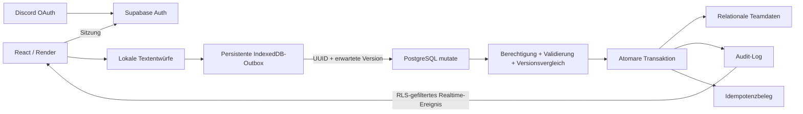

# Architektur

## Datenfluss

## Tabellen

`teams` umfasst den Workspace. `profiles` gehört zu Supabase-Auth-Konten; `user_permissions` verbindet Konten und Teams samt Modulen. `team_members` beschreibt Roleplay-Teammitglieder und benötigt keinen eigenen Login. `roles` und `member_roles` bilden Mehrfachzuweisungen ab. Ränge, Zusatzrollen und erhaltene Sonderrollen sind getrennte Rollenkategorien.

`access_requests` speichert Zugangsanfragen mit bestätigter Discord-ID, Status und Entscheidung. Anfragende sehen nur ihre eigene Anfrage; nur Teamadministratoren sehen andere Anfragen. Die RPC `review_access_request` prüft Administratorrecht, Version und die weiterhin bestehende Discord-Identität. Rechte und Entscheidung werden atomar gespeichert. Bestehende Rechte werden durch eine Anfrage nicht überschrieben.

`sync_discord_profile` übernimmt die ID aus `auth.identities` und erhält bestehende Anzeigenamen. Ein Trigger prüft die nur für den Datenbankeigentümer bearbeitbare `discord_admin_allowlist`. Die fünf ausdrücklich vorgegebenen IDs erhalten ausschließlich im eindeutig benannten Team „Nexville Roleplay“ Administratorrechte. Wiederholte Anmeldungen erzeugen keine erneuten Rechteänderungen, solange das Recht bereits besteht. Andere Teams erhalten dadurch keinen zusätzlichen Administrator. Die Migration berücksichtigt auch bereits vorhandene bestätigte Discord-Identitäten.

`meetings`, `meeting_topics` und `meeting_attendance` sind eigenständige Datensätze je Sitzung. Ein Unique-Constraint verhindert doppelte Anwesenheit desselben Mitglieds in einer Sitzung. Name und Rollen werden bei Erstellung als Snapshot erfasst. Archivierte Mitglieder bleiben referenzierbar.

`warnings` enthält alle ursprünglichen Verwarnungen. `warning_status` ist eine RLS-sichere `security_invoker`-View, die Aktivität in Europe/Berlin berechnet. `team_wishes` bildet den vollständigen Wunschlebenszyklus ab. `audit_logs` enthält servergenerierte Änderungen. `mutation_receipts` speichert autorisierte Vorgänge zur sicheren Wiederholung; Browser dürfen diese Tabelle nicht direkt lesen oder ändern.

## Transaktionen und Konflikte

`mutate` whitelisted Tabellen und Felder, prüft `auth.uid()`, Teamrolle und freigegebenes Modul. Ein Advisory Lock serialisiert doppelte Operation-IDs. Ein Zeilenlock plus erwartete Version erkennt parallele Änderungen. Die Datenbank erhöht die Version selbst. Ein Mitglied einschließlich seiner Rollen wird gemeinsam committed oder vollständig zurückgerollt. Dasselbe gilt für die Anlage einer Sitzung samt Themen und Anwesenheitsliste.

Die Outbox sendet in Reihenfolge. Jede Operation liegt separat in IndexedDB, damit neue Vorgänge anderer Tabs nicht durch eine komplette Warteschlangenüberschreibung verschwinden. Die Anwendung bestätigt Erfolg nach Serverantwort und Aktualisierung der Daten. Lokale Fehler und Versionskonflikte behalten die Entwürfe. Es gibt kein automatisches „letzter Schreibvorgang gewinnt“.

## Sicherheitsgrenze

Die Browserumgebung erhält ausschließlich den öffentlichen Supabase-Key. Auth prüft die Sitzung; RLS filtert Leser. Direkte Tabellenwrites sind entzogen. Security-Definer-Funktionen verwenden einen leeren `search_path`, explizite Schemaangaben und eingeschränkte EXECUTE-Grants. Die Oberfläche bietet ausschließlich Discord als Anmeldeweg an. Der gehostete E-Mail-Anbieter wird separat in Supabase deaktiviert. Vorhandene Einladungsfunktionen bleiben als ungenutzter Altbestand erhalten.

Backups und Wiederherstellung wurden vom Auftraggeber zurückgestellt und sind nicht Teil dieser Architekturversion.
